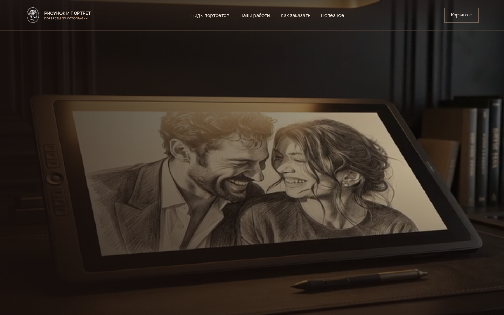
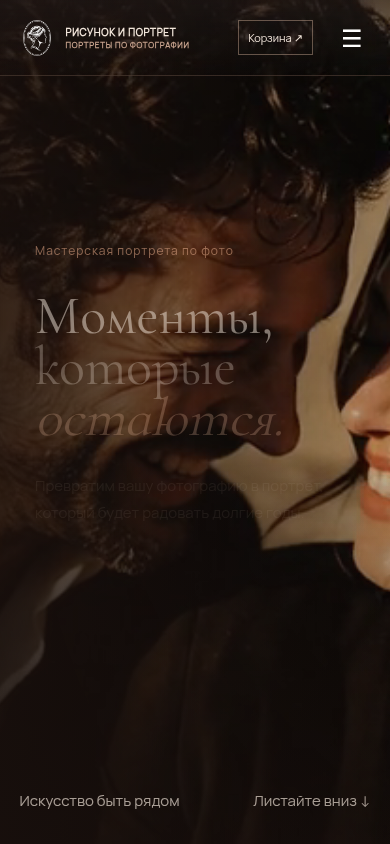
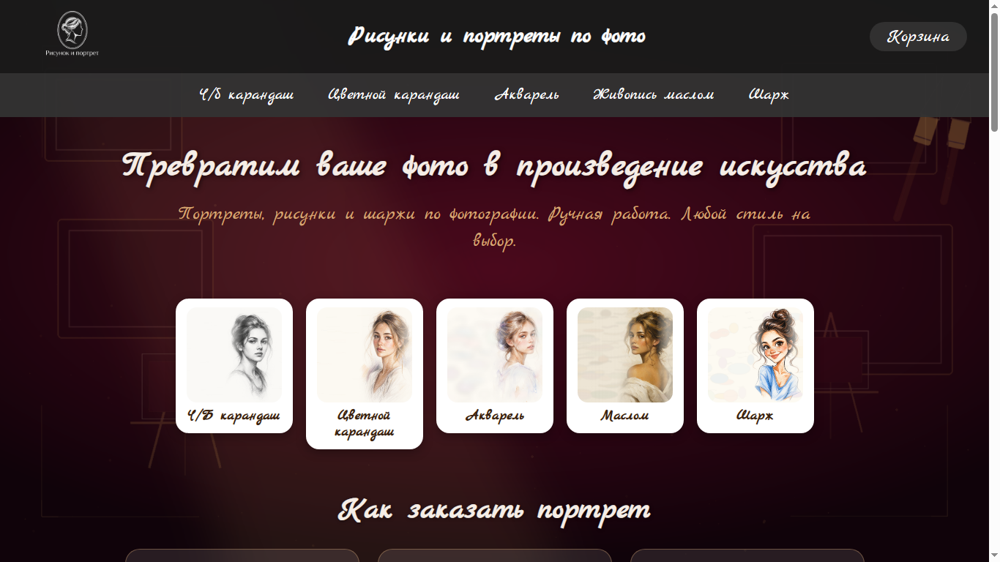
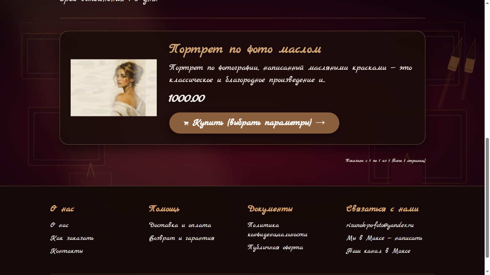
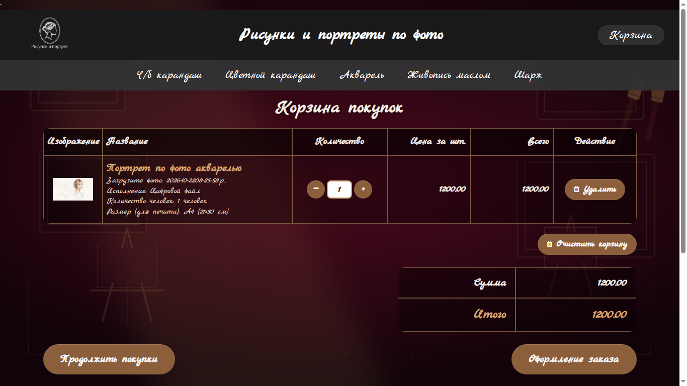

# Интернет-магазин «Рисунок-портрет»

## Демо

**[Открыть сайт →](https://рисунок-портрет.рф)**

Полноценный интернет-магазин по продаже портретов ручной работы на CMS OpenCart 3.

## 🔗 Живой сайт
[рисунок-портрет.рф](https://рисунок-портрет.рф)

## 🛠 Что было сделано:
- **Настройка CMS:** Установка и конфигурация OpenCart 3 на хостинг.
- **Дизайн и верстка:** Настройка шаблона под тематику магазина, адаптация под мобильные устройства.
- **Каталог и заказы:** Настройка структуры каталога, карточек товаров, корзины и полного цикла оформления заказа.
- **Интеграции:** Подключение платежных систем (эквайринг) и служб доставки (СДЭК, Почта России).
- **SEO:** Базовая оптимизация (мета-теги, ЧПУ, sitemap).
- **Аналитика:** Подключение Яндекс.Метрики.

## 📸 Скриншоты

